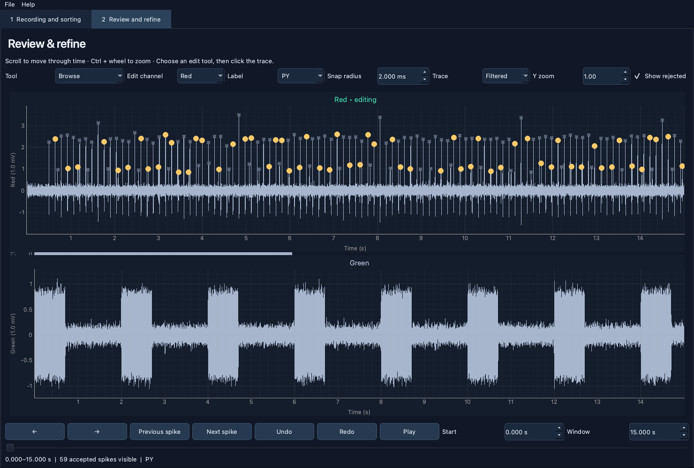

# Lobsort

A desktop application for the spike-sorting workflow in `spike_sort_v3.ipynb`, with a final manual curation step. No Jupyter session is required.



## Start the app

Requires Python 3.10 or newer. Python 3.11 or 3.12 is recommended for a fresh installation.

**macOS:** double-click **Launch Lobsort.command**. The first launch creates a private Python environment beside the app and installs its dependencies; it needs internet access. If Finder opens the file as text, run it from Terminal with `bash "Launch Lobsort.command"`.

**Windows:** double-click **Launch Lobsort.bat** with Python installed.

**Linux or manual installation:**

```sh
python3 -m venv .venv
source .venv/bin/activate
python -m pip install -e .
lobsort
```

Use **File → Open demo recording** to try the interface with deterministic synthetic signals. You can also start with `lobsort --demo`.

## Sort a recording

1. Choose an `.smr` or `.abf` file and click **Load recording**. Choose a segment if the recording has multiple segments; numbering starts at zero. Neo must support the particular recording format/version. SMRX files require a separate CED reader and are not supported in this release.
2. Choose the target channel, rhythm reference channel, and project folder. Preview all channels in **Review and refine**.
3. Open **Adjust pipeline settings**. Set each channel's artifact cutoff in **mV**, bandpass limits, detection threshold, polarity, and shadow period. Set neuron names and desired example counts under **Training**. Defaults are starting points from the notebook, not universal physiological settings.
4. Click **Filter and detect candidates**. Filtering runs for the target and reference channels. Masked artifacts appear as gaps in the filtered trace.
5. Click **Label training examples**. The original time/amplitude-stratified labeling window presents candidates alongside the reference trace. Use the labeled buttons or number keys, **S** to skip, and **U** to undo. Labels save immediately. You can import a compatible training-label CSV instead.
6. Choose **Context-aware classifier** or **Waveform classifier**, then **Train and classify**. Validation results appear in the progress panel; logs, models, candidate tables, and diagnostic images are saved in the channel/settings workspace. For later recordings, detect candidates and choose **Reuse a saved classifier** instead.
7. Review and correct the result, save the review, then export curated spikes. Repeat for other target channels; their tables accumulate in the review.

Label examples across the recording and include noise. At least three examples per class in two classes are needed to start training; the original larger per-class targets are preferable. Validation scores describe held-out manual labels, not guaranteed recording-wide accuracy.

**Transferred waveform models:** the notebook's transfer consistency rules accept the neuron named **Neuron for burst checks / transferred waveform model**. Set this to the neuron being sorted (default `PY`). Context classifiers can accept multiple neuron labels. Optional within-burst ISI rejection and sequence-supported moderate-confidence acceptance are exposed in settings. Moderate-confidence spikes are excluded from final automatic acceptance by default, matching the notebook's high-confidence export choice; rejected candidates remain available for manual restoration.

## Correct spikes by hand

- Browse with the time slider, mouse wheel, left/right keys, **Play**, or previous/next spike buttons. Use **Ctrl + wheel** or the window-length control to zoom in time. Switch between raw and filtered traces; use Y zoom for voltage scaling.
- Choose the **edit channel** and a **neuron label**.
- **Add / restore spike:** click a missed event or rejected marker. A new event snaps to the local peak according to detection polarity within the chosen snap radius. A radius of zero selects the nearest sample. Adding does not require an existing detected candidate.
- **Deselect spike:** click an accepted marker. It stays in the all-candidate table but is excluded from curated spike exports.
- **Relabel spike:** click a marker to assign the chosen neuron label.
- **Undo / Redo:** reverse or restore edits in the current session. The review keeps an audit history of edits. Undo stacks restart when reopening a project or replacing a channel table.

Zoom to individual events before editing densely packed spikes. Adds in filtered artifact gaps are blocked; revise filtering to recover events excluded by artifact settings. Automatic decisions are preserved in `automatic_label` and `automatic_accepted`; manual decisions use `manual_label`, `accepted_as_spike`, and `edit_source`.

## Save, resume, and export

**File → Save review** writes a `.lobsort` project containing raw/filtered signals, artifact masks, candidate decisions, metadata, channel settings, event markers, and edit history. The file is self-contained and can be reopened without the original recording. Saves replace the project atomically. Save periodically during final review; final edits are not automatically saved after each click. Training labels save separately as you label.

**File → Export curated spikes** writes, for each reviewed channel:

- `*_curated_spikes.csv`: accepted spikes, sorted by time, with `spike_number`, `time_seconds`, `sample_index`, `channel`, and `manual_label`.
- `*_all_candidates.csv`: accepted and rejected candidates, original predictions/confidences, and manual provenance.
- `edit_history.json`, `settings.json`, and a complete `review.lobsort` snapshot.

Exports honor manual overrides, including manually added spikes with no classifier confidence. Empty accepted tables still export column headers. Spike times are absolute recording seconds; indices are zero-based within the selected segment/channel.

You can import existing notebook spike CSVs through **File → Import sorted spike CSV**, select their channel, and curate them in the same viewer. CSVs need `time_seconds`; `manual_label` or `predicted_label` is used when present. Recording event markers can be exported separately. Settings profiles can also be saved and loaded.

Project folders contain a workspace identified by recording path, segment, and settings. Changing detection settings uses a different training-label workspace to avoid silently mixing incompatible candidates. Keep different recordings in distinct project folders. Before reclassifying a manually edited channel, the app saves `before_reclassification.lobsort` in its workspace.

## Models and resource use

Existing notebook waveform `.joblib` packages with `classifier`, `feature_columns`, and `feature_medians` are supported. New context models also store feature settings and sampling rate; reuse at a different sampling rate is rejected. Use matching preprocessing, channel meaning, voltage units, and recording conditions when transferring a model. Only open trusted joblib files, since this Python serialization format can execute code when loaded.

Recordings are loaded eagerly, as in the notebook. Long recordings and self-contained review projects may require substantial memory and storage. Filtering and training run in a background thread; project saving and exporting can take time for large recordings.

## Development and validation

```sh
python -m unittest discover -s tests -v
```

The tests exercise detection equivalence with the notebook, both training and model-transfer paths, empty detection, manual additions/removals/relabeling, undo/redo, artifact guards, review round-trips, curated exports, and GUI editing. CI runs the tests on Linux with an offscreen Qt interface.

Initial local validation used synthetic recordings. The notebook's hardcoded example SMR file was unavailable, so real-recording input and biological sorting accuracy remain unvalidated. Manual review supports correction but cannot guarantee 100% accuracy.

See [PORTING.md](PORTING.md) for notebook-stage mapping and intentional changes.
